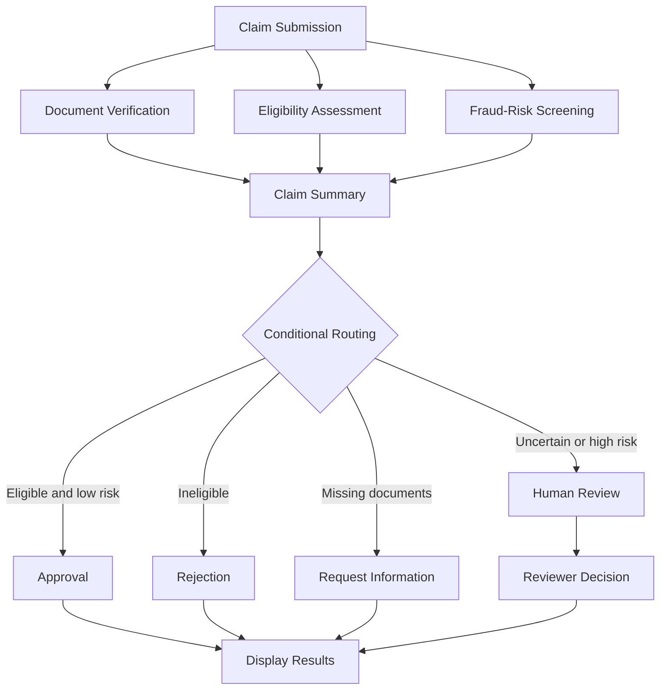

# Insurance Claim Processing Agent

An AI-powered insurance claim processing application built with **Python, LangGraph, and Streamlit**. The system automates key claim assessment tasks, including document verification, policy eligibility checks, fraud-risk screening, claim summarization, and decision routing, with human review for cases that require additional judgment.

## Project Overview

Processing insurance claims manually can be time-consuming and prone to inconsistent decisions. This project demonstrates how an agentic AI workflow can coordinate multiple specialized agents to evaluate claims and present the results through an interactive web application.

The workflow uses rule-based validation and can be extended with a Large Language Model (LLM), such as GPT-4o-mini, for supported language-processing tasks.

## Key Features

- **Document Verification:** Checks whether required claim documents have been provided.
- **Eligibility Assessment:** Evaluates policy dates, coverage availability, claim amounts, and coverage limits.
- **Fraud-Risk Screening:** Identifies configured suspicious indicators and flags high-value claims for review.
- **Claim Summarization:** Combines assessment results into a readable claim summary.
- **Conditional Routing:** Directs claims toward approval, rejection, additional information, or human review.
- **Human-in-the-Loop:** Allows a reviewer to inspect flagged claims and submit a decision.
- **Parallel Processing:** Runs document, eligibility, and fraud checks concurrently where configured in the LangGraph workflow.
- **Interactive Dashboard:** Provides a Streamlit interface for entering claim details and reviewing outcomes.

## Technology Stack

| Technology | Purpose |
|---|---|
| Python | Core application logic |
| LangGraph | Agent workflow orchestration and conditional routing |
| Streamlit | Interactive web interface |
| LangChain | LLM integration, if used by the configured agents |
| OpenAI API | Optional LLM-powered processing, if configured |
| Git and GitHub | Version control and project hosting |

## Project Structure

```text
insurance-claim-process-agent/
│
├── app.py
├── test_workflow.py
├── requirements.txt
├── .env.example
├── .gitignore
│
├── agents/
│   ├── __init__.py
│   ├── document_agent.py
│   ├── eligibility_agent.py
│   ├── fraud_agent.py
│   ├── summary_agent.py
│   └── human_approval_agent.py
│
└── graph/
    ├── __init__.py
    ├── state.py
    ├── routing.py
    └── workflow.py
```

The structure above represents the intended organization. Keep only files that exist in your repository, and update the tree if your project differs.

## Workflow Architecture

The application follows a multi-stage claim processing workflow:

1. **Claim Submission:** The user enters claimant details, policy information, incident dates, claim amount, and document information.
2. **Parallel Assessment:** The document verification, eligibility assessment, and fraud-risk screening agents independently evaluate the claim.
3. **Claim Summary:** The workflow combines the assessment results into a structured summary.
4. **Decision Routing:** Conditional logic determines the next step based on the assessment outcomes.
5. **Human Review:** Claims requiring additional judgment can be paused for reviewer input.
6. **Final Result:** The application displays the available assessment results and final status.

### Workflow Diagram



The exact routing behavior depends on the rules implemented in `graph/routing.py`.

## Installation

### 1. Clone the repository

```bash
git clone https://github.com/YOUR_USERNAME/insurance-claim-process-agent.git
cd insurance-claim-process-agent
```

Replace `YOUR_USERNAME` with your GitHub username.

### 2. Create a virtual environment

```bash
python -m venv .venv
```

Activate it on Windows:

```bash
.venv\Scripts\activate
```

### 3. Install dependencies

```bash
pip install -r requirements.txt
```

Ensure `requirements.txt` contains the packages required by your actual implementation, including Streamlit and LangGraph, plus any LangChain or LLM provider packages you use.

### 4. Configure environment variables

If your application uses the OpenAI API, create a local `.env` file:

```env
OPENAI_API_KEY=your_api_key_here
```

Keep `.env` out of Git. If the application does not use an LLM yet, this configuration is optional.

## Running the Application

Start the Streamlit application from the project root:

```bash
streamlit run app.py
```

Open the local URL printed in the terminal, usually:

`http://localhost:8501`

Enter the claim information, select the provided documents, add any relevant suspicious indicators, and click **Process Insurance Claim**. Review the resulting assessment and submit a human-review decision if prompted.

## Testing

Run the workflow tests from the project root:

```bash
python test_workflow.py
```

The test script can exercise representative scenarios, including:

### Scenario 1: Valid Claim

- Incident date falls within the policy period.
- Coverage is available.
- Claim amount is within the coverage limit.
- All required documents are listed as provided.
- No suspicious indicators are configured.

**Expected behavior:** The workflow evaluates the claim and may approve it if all configured approval conditions are satisfied.

### Scenario 2: Missing Documents

- One or more required documents are not listed as provided.

**Expected behavior:** The workflow should identify the missing documents and request additional information when configured to do so.

### Scenario 3: High-Value Claim

- The claim amount exceeds the configured high-value threshold.

**Expected behavior:** The claim is flagged for human review according to the routing rules.

Additional tests should cover expired policies, incidents outside the policy period, unavailable coverage, suspicious indicators, and reviewer rejection.

## Configuration and Customization

The following project files contain the primary workflow logic:

- `graph/state.py` — Defines the data shared between workflow nodes.
- `graph/workflow.py` — Builds and compiles the LangGraph workflow.
- `graph/routing.py` — Defines conditional claim routing rules.
- `agents/document_agent.py` — Implements document checks.
- `agents/eligibility_agent.py` — Implements policy eligibility checks.
- `agents/fraud_agent.py` — Implements risk-indicator checks.
- `agents/summary_agent.py` — Generates the claim assessment summary.
- `agents/human_approval_agent.py` — Handles human-review interruptions.
- `app.py` — Implements the Streamlit interface.
- `test_workflow.py` — Runs workflow test scenarios.

Adjust thresholds and business rules to match the intended demonstration or assessment requirements.

## Current Limitations

- Document verification currently checks document names and does not necessarily inspect the contents of uploaded files.
- Fraud screening identifies configured risk indicators; it does not establish that fraud has occurred.
- Assessment quality depends on the implemented rules and any configured LLM.
- The application is a development demonstration and has not been established as a production-ready insurance adjudication system.
- Real insurance decisions require validated policy data, appropriate security controls, audit trails, and qualified human oversight.

## Security Considerations

- Never commit API keys, passwords, personal claim documents, or other sensitive information to GitHub.
- Store secrets in environment variables or an appropriate secrets manager.
- Use fictional claim data for public demonstrations.
- Add authentication, access controls, logging, and secure data handling before deployment with real customer information.

## Future Enhancements

- Upload and extract information from PDF claim documents.
- Add OCR for scanned documents.
- Integrate an LLM for structured extraction and evidence-grounded summaries.
- Persist claim records and reviewer decisions in a database.
- Add audit logging and claim-status tracking.
- Improve fraud-risk assessment with validated data and explainable indicators.
- Deploy the application to a suitable hosting platform.

## Author

**Joyal Joseph**

GitHub: [J0YA1](https://github.com/J0YA1)

## Disclaimer

This project is intended for educational and demonstration purposes. Its automated outputs are not a substitute for official policy interpretation, validated fraud investigation, or authorized insurance decisions.
